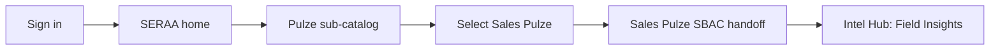
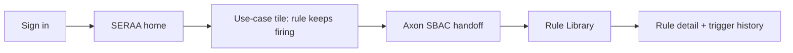
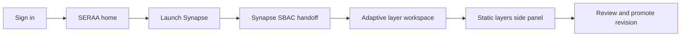
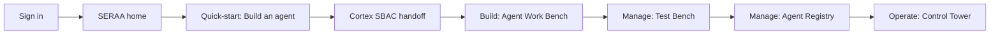
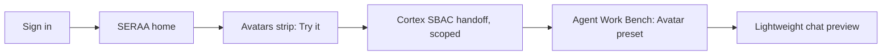
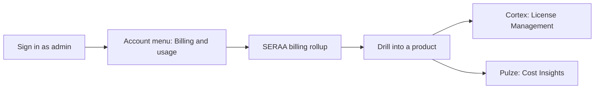

# SERAA — Unified Platform IA & UX Flow

2026-09-16 · @Rashi Saxena

## Product & module map

SERAA is the umbrella. Under it: **Pulze**, **Axon**, **Synapse**, **Cortex** — plus **Assure**, which stays a cross-cutting governance concept, not a fifth product tile.

### SERAA Pulze — three sellable products, one shell family

Sold alone, in any pair, or as the full Pulze bundle:

- **Sales Pulze** (built): Intel Hub, Meeting Repository, Action Center under _Platform_; Admin Dashboard, Meeting Board, Users & Roles, Scopes & Structure, Cost Insights, Business Segments under _Administration_; System Configuration under _Settings_.
- **Market Pulze**: mirrors the Sales Pulze shell, market-sentiment focus.
- **Liquidity Pulze**: new addition, expected to follow the same shell.

Each has its own left-nav today. Under SERAA, the three share one Pulze-level shell with locked-but-visible sections for modules not purchased — the same pattern already built for the MYK Intelligence Suite (Field + Market sharing one sidebar).

### SERAA Axon (formerly Ariia) — single product, no micro-frontends

Icon rail (chat, insights, rule library, workflows, data, settings) plus a **System / Org / Project** scope selector in the top bar. Core surfaces today: **Rule Library** (semantic + SQL rules, severity-tagged, trigger counts) and **Insights** (AI-generated KPIs with confidence bands, category distribution, KPI feed). Multiple agents and imagery analysis sit alongside these, not yet screenshotted.

### SERAA Synapse (ECC) — single standalone product, no micro-frontends

A workspace where the user quickly creates memory. One **Adaptive Layer** is directly user-facing and learns continuously; every other layer is static and reaches the adaptive layer's learning only through revision and promotion — the Promotion Review Queue model already scoped for ECC.

### SERAA Cortex (formerly CAMS) — the widest surface, modular by design

Each module independently sellable, or the full suite:

- **Agent Management** — AI Strategy Compass, AI Usecase Builder, Agent Work Bench, Multi-Agent Orchestration, Agent Registry, Agent Test Bench, Agent Control Tower
- **Agent Intelligence** — Forecasting, Classification, Optimization
- **Data Management** — Unified Data Ingestion, Data Quality, Unified Risk Model, Data Security & Governance (EDMS)
- **Enterprise Connectors** — Data Connectors, BPM/RPA Connectors, Middleware Connectors
- **Administration** — System Configuration, System Monitoring, License Management, Tenant Administration

Cortex's own home is already catalog-shaped — search bar, quick-launch cards, tabbed categories, Active/Coming Soon status — closer to an Azure or Google Cloud portal home than a KPI dashboard. Each launched module (e.g. Agent Work Bench) opens its own left-nav shell with an app-switcher back to the catalog.

## Architecture principles

**Three tiers**: SERAA (umbrella — discovery, sign-in, cross-product launch) → Product (Pulze / Axon / Synapse / Cortex) → Module (Sales Pulze's Intel Hub, Cortex's Agent Work Bench, etc.).

**SBAC stays standalone per product, on purpose, for now.** Each product keeps its own hierarchy, its own session, its own entitlement table:

- Cortex: System → Org Unit → Project
- Axon: System → Organisation → Project (its current breadcrumb)
- Synapse: Tenant → Project → Layer
- Pulze: its own scope + role model per the SalesPulze admin console

No shared identity graph yet. SERAA sits above these as a thin discovery-and-launch layer: one sign-in surface, one home, one catalog — but clicking into a product hands off into that product's own auth boundary, the way Azure's "Go to Foundry" link opens a separately-scoped experience rather than carrying Azure IAM wholesale into it.

**Designed so unification is a later addition, not a rebuild:**

- Keep one canonical org/tenant identifier at the SERAA level that each product's top scope node can optionally resolve to later (Cortex's Org Unit, Synapse's Tenant, Axon's Organisation becoming the same node is a mapping exercise then, not a migration now).
- Model entitlement (Active / Coming soon / not purchased, per product and per module) as a SERAA-level flag today, even though each product still enforces its own permissions underneath — this is the seam a future unified SBAC slots into.
- One identity for the person (name, avatar, email) lives at the SERAA shell and is reused in every product's account menu, even while each product still checks its own permission tables.

**What does _not_ unify yet:** role definitions, permission packs, audit logs, and org hierarchies inside each product. Those stay product-specific until unification is its own scoped project.

## Sign-in & entry flow

1. **SERAA sign-in** — successor to today's "Covasant Agent Management Suite" login: Organisation/Tenant selector, email + password, SSO (AWS, Microsoft, Google). Same shell, SERAA branding, same left marketing panel now introducing the platform rather than one product.
2. **Resolve entitlement, then land on SERAA home** — never straight into a product. SERAA checks what the org has purchased across Pulze, Axon, Synapse, Cortex (the entitlement flags from Architecture principles) before rendering the home page.
3. **Locked-but-visible, always** — an org that only owns Sales Pulze still sees all four product tiles on SERAA home; unpurchased ones are dimmed with "Request access" / "Learn more" rather than hidden. Same logic already built for the MYK Suite and Cortex's own catalog (Active vs Coming soon).
4. **Launch = handoff, not merge** — clicking into a product passes the person's SERAA identity and org hint, then that product's own SBAC takes over: its own scope selector, its own session. Existing account in that product → silent handoff. No account yet → a first-run provisioning step creates their user record there against the shared org hint.
5. **Home is the front door, not a skip-through** — SERAA remembers the last product used (a Recents-style shortcut), but every session opens at SERAA home first, matching Databricks' homepage-first pattern rather than deep-link-only entry.

## SERAA home page IA

Not a KPI dashboard — a catalog-and-discovery home, closer to Azure's "Let's start building" + Google Cloud's model/agent home + Foundry's welcome screen than to Cortex's own internal Control Tower.

**Top bar** — SERAA wordmark · global nav (Home · Discover · Pricing · Docs) · organization indicator (read-only; user belongs to one org only, no top switching) · notifications · account menu. Pricing lives here as a persistent tab, not buried in a product.

**Hero** — "Welcome, \[name\]" (Azure-style personalization) with a prominent **ask bar** front and center: _"Ask SERAA — analyze this month's meetings, build an agent, check a rule…"_ with a send action. This is the Vertex AI / Gemini Enterprise pattern (a search-as-entry-point hero) rather than a static banner.

**Quick-start triad** (Foundry's Use a model / Build an agent / Code an agent pattern, re-cast per SERAA's own verbs): three large cards —

- _Analyze something_ → routes into Pulze's Intel Hub
- _Build an agent_ → routes into Cortex's Agent Work Bench
- _Try an Avatar_ → routes into the Avatars picker

**Use-case strip** (Google Cloud's "want to do X, try this" framing — pain-point language, not product names):

- "Your team logged 300 meetings this month — want the highlights?" → Sales Pulze Intel Hub
- "See which rule keeps firing and why" → Axon Rule Library
- "Give your agent a memory that improves on its own" → Synapse
- "Ship your first agent this afternoon" → Cortex Agent Work Bench

Each tile names the pain, not the product — the product name only shows as a small tag in the corner, the way Google Cloud surfaces a capability before the underlying service name.

**Avatars strip** — "Meet your Avatars," a horizontal carousel (mirrors Google Cloud's "Try Models" row): avatar name, one-line persona, _Try it_ button. Surfaced high on the page since Avatars are new and cross-cutting rather than owned by one product.

**All products row** — one card per product, made-up identity for now:

| Product | Mark            | Color  | One-liner                                  |
| ------- | --------------- | ------ | ------------------------------------------ |
| Pulze   | pulse/radar     | teal   | Sense — meetings, market signal, liquidity |
| Axon    | node cluster    | purple | Reason — rules and data intelligence       |
| Synapse | layered hexagon | pink   | Remember — memory that adapts              |
| Cortex  | hex/robot       | coral  | Act — build, deploy, run agents            |

Pulze's card shows its three sub-products (Sales / Market / Liquidity) as a compact sub-row rather than three separate top-level cards. Assure does **not** get a tile — it shows as a thin persistent governance strip beneath the row ("Assure is watching 4 products, 0 open risk items") linking into whichever product owns the actual audit surface today.

Each card carries Active / Coming soon / Locked state and a _Launch_ button, exactly like Cortex's existing catalog cards — this pattern is simply promoted up to the SERAA level.

**Recents strip** (Databricks pattern) — "Continue where you left off," recently opened modules across all four products, entitlement-filtered automatically.

**Footer** — Docs, What's new, Covasant attribution.

Navigation _into_ each product differs by design once launched (detailed next section) — SERAA home's job is discovery and hand-off, not dictating each product's internal shell.

## Billing & management surfacing

Two entry points, kept deliberately separate:

- **Pricing** (top-nav tab) — public plan comparison and upgrade paths, same audience as a marketing pricing page. Not transactional.
- **Billing & Usage** (account menu, admin-only) — this cycle's spend, next invoice, payment method, and a per-product table: Product · Plan/Tier · Seats or usage · Cost this cycle · Manage. Each _Manage_ link deep-links into that product's own billing/admin screen (Cortex's License Management, Pulze's Cost Insights) — billing enforcement stays standalone per product for now, same as SBAC. SERAA's Billing tab is a rollup and a set of doors, not the system of record.

**Assure lives inside the SERAA shell, not as a product.** It's a persistent dashboard surface (reachable from SERAA home and the account menu) summarizing which products are active, their cost, billing status, and any compliance flags — a control-plane view over each product's own standalone billing/SBAC, not a fifth system to reconcile.

## Per-product navigation patterns

One convention holds across all four regardless of how different the rest of the shell is: the same small app-switcher icon top-left ("back to SERAA"), and the same account-menu position top-right, reused from the SERAA identity even though it drives separate permission checks per product.

### Pulze (Sales / Market / Liquidity)

Keep the existing left-nav shell as built — _Platform_ (Intel Hub, Meeting Repository, Action Center), _Administration_, _Settings_, _Info_. Under SERAA it gains one thin strip above it: back-to-SERAA breadcrumb + a product switcher between Sales / Market / Liquidity for orgs that own more than one — the same "one sidebar, section per module" logic already built for the MYK Suite. No change to density: this is a data-dense daily-use tool, correctly optimized for that, not for discovery.

### Axon

Keep the icon rail and the System / Organisation / Project breadcrumb exactly as is — with no micro-frontends, that breadcrumb is the only wayfinding device inside the product, so it stays the single source of scope rather than gaining a second nav layer on top.

### Synapse

Stays workspace-first, not page-list-first: one adaptive-layer canvas front and center, with static layers reachable through a side panel (versioned, promotable) rather than a left-nav list. The adaptive layer should feel immediate and alive; the static layers should feel like a governed archive one level back — the nav should make that difference legible, not flatten it into equal-weight sidebar items.

### Cortex — Foundry's top nav over the existing catalog

The biggest shift. Cortex's home is already catalog-shaped (search, quick-launch cards, tabbed categories) — keep it, but reframe it as one destination among several rather than the only screen, using Microsoft Foundry's persistent top nav:

**Home · Discover · Build · Operate · Manage · Docs**

Mapped onto Cortex's existing modules and agent lifecycle (Draft → In Review → Registered → Deployed):

- **Home** — today's catalog screen (search + quick-launch + category tabs), unchanged, just no longer the only screen.
- **Discover** — new, modeled on Foundry's Discover tab: agent templates, pre-built rule sets, connectors, marketplace-style content; a natural home for AI Strategy Compass and AI Usecase Builder output, and later a template gallery.
- **Build** — Agent Work Bench and Multi-Agent Orchestration live here — where an agent is actually authored.
- **Operate** — Agent Control Tower moves here, styled directly on Foundry's Operate tab (Active alerts, Running agents, Estimated cost, Agent success rate, Token usage, Agent run volume) — the two are already close to a one-to-one match.
- **Manage** — Agent Registry, Test Bench, System Configuration, License Management, Tenant Administration, Data Security & Governance converge here, mirroring Foundry's Manage tab (Quota, AI Gateway, Resource/Project details, Users, Connected resources).
- **Docs** — as-is.

Each top-nav destination keeps its own left nav for what's nested under it (Manage's left nav: Quota, AI Gateway, Resource details, Project details), exactly as Foundry does it. The System / Org / Project scope selector stays in the breadcrumb beside the Cortex wordmark — same visual convention as Axon's, even though each keeps its own SBAC underneath.

|     |     |     |
| --- | --- | --- |
|     |     |     |
|     |     |     |

## Navigation flows — first iteration

Six representative use cases, one flow diagram each, covering all four products and Billing.

**1. Sales leader analyzes the team's meetings (Pulze)**

**2. Compliance investigates a flagged rule (Axon)**

**3. Knowledge manager promotes a memory (Synapse)**

**4. Developer ships an agent end-to-end (Cortex)**

**5. Anyone tries an Avatar**

Avatars run inside Cortex's Agent Work Bench as a built-in preset, not a separate product surface.

**6. Admin reviews billing across products**

## Decisions

- Pulze's tile routes to a Pulze-level sub-catalog first, before Sales / Market / Liquidity.
- Pricing lives on its own tab, separate from the transactional Billing & Usage view.
- Avatars are part of Cortex, built into Agent Work Bench as a preset — not a separate product.
- First-run provisioning into a newly-entitled product leans toward requiring admin approval rather than being automatic on first _Launch_ — provisional, pending final confirmation.
- Assure is not a separate product; it's a dashboard surface inside the SERAA shell summarizing products, cost, and billing across the suite.
- Product icons and colors in this doc are placeholders pending real identity work.
- Liquidity Pulze mirrors the Sales/Market Pulze IA for now.

**Next step:** wireframes — SERAA home, the sign-in/handoff sequence, Cortex's Foundry-style top nav, and the Billing & Usage rollup are the highest-value screens to start with.

## Home page rework v2 (Google Cloud–inspired)

Structure now follows Google Cloud's console home more closely: a dismissible top banner, hero with ask bar, quick-start triad, a reworked use-case section, character-style Avatars, a Try Models strip, product-specific connector strips, an Activate-other-products card, and a full footer.

**Top banner (new)** — a dismissible strip above the hero, mirroring Google Cloud's "Access the full suite" banner: _"You're using 2 of 4 SERAA products — unlock Axon and Synapse"_ + an _Activate now_ button. Same destination as the bottom Activate-other-products card, just surfaced earlier for visibility.

**Avatars — not generic cards.** Avatars are pixel-art character agents with an identity, not plain text tiles. Each card gets a distinct pixel-character portrait (a small illustrated square, not initials-in-a-circle), name, one-line persona, and a _Try it_ button — closer to a game character-select tile than a feature card. Keep the product-preset tag, but make it secondary to the character art.

**Per-product identity — distinct, not identical cards.** Each product card in the All Products row gets its own icon and treatment, not the same card shape recolored: Pulze a radar/pulse mark, Axon a node-cluster mark, Synapse a layered-hexagon mark, Cortex a hex/robot mark — rendered as a real small icon, per the original mark/color table.

**"I want to…" — reworked presentation.** Move from quote-style cards to the same icon-first treatment as the Quick-start triad (icon in a colored badge, title, one-line description, link) for visual consistency — quote marks removed, headline shortened to a plain task phrase. Keep the product-name pill in the corner. Axon's card specifically uses a vaguer, less domain-specific use case since the detailed use case isn't settled — e.g. "Analyze your plantation data" rather than a rule-specific claim.

**Try Models strip (new)** — mirrors Google Cloud's "Try Models" row: model cards (name, provider badge, one-line description, _Try_ button) listing the underlying models available across SERAA's agents (Claude Opus, Gemini, GPT, etc.). A SERAA-shell-level capability, not owned by one product.

**Connect your tools (new, contextual per product)** — a second horizontal strip, laid out like Try Models but for data/meeting connectors: Google Meet, Microsoft Teams, Zoom, SAP, Salesforce, Snowflake, etc., each showing a connect/connected state. Which connectors surface here is contextual — meeting-platform connectors sit near Pulze's use case, ERP/data-source connectors near Axon's — and a connection made here should show as already-connected inside that product's own settings, not asked for twice.

**Activate other products (new, bottom of page)** — mirrors Google Cloud's "Activate full account" card: a checklist of what unlocks (e.g. "4 products, 12 modules, unlimited agent runs") plus 2–3 highlight boxes, and an _Activate_ button. Placed near the end of the page, just before the footer.

**Footer (new)** — Docs · Help · Security · Privacy Policy · Terms, plus a "© Covasant" line, matching a standard enterprise console footer.

## Top-left app switcher, agent rail, and utility drawers

**App switcher drawer.** The existing top-left grid icon, when clicked, opens an overlay panel from that corner (not a page navigation) listing every product as an app icon in a grid — the same interaction as Microsoft's "Microsoft Cloud" waffle menu — so switching products never leaves the current page unless the person clicks a tile inside the panel.

**Thin agent icon rail — SERAA home only.** A narrow, icon-only vertical rail (distinct from any product's own left nav) showing the org's available agents/avatars as small icons for quick access — exists only on the SERAA home page, not inside any product shell.

**Assistant icon + right-side drawers.** A persistent assistant icon (separate from the hero ask bar) opens a right-side drawer for its answers rather than navigating away. The same right-drawer pattern applies to the top bar's notifications and settings icons — both open a drawer from the right rather than a new screen, keeping the person anchored on SERAA home.

## Discover — two separate pages, not one

There are now two distinct Discover surfaces, and they must not redirect into each other:

- **SERAA-level Discover** (`site/discover.html`) — reached from the Home · Discover · Pricing · Docs nav on SERAA home itself. This is the cross-product browsing surface: Featured (curated templates and prebuilt agents across every product), Browse by product (one row per product — Pulze, Axon, Synapse, Cortex), Browse by capability (meeting intelligence, rule automation, memory, agent orchestration), and a Models section reusing the Try Models card style from home.
- **Cortex-level Discover** (`cortex/discover.html`) — reached only from inside Cortex's own six-item top nav (Home · Discover · Build · Operate · Manage · Docs), scoped to Cortex's own templates, rule sets, and connectors, modeled on Microsoft Foundry's Discover tab.

The two share a family resemblance (same card styles, same section-header pattern) since they're both "browse" surfaces, but they are separate pages with separate content scopes — SERAA home's Discover link must never simply redirect to Cortex's.

## Assistant — entitlement-aware routing

The hero ask bar and the persistent assistant icon are two entry points into **one** assistant, not two separate ones — both open the same right-side drawer and continue the same thread.

**What it knows (hardcoded for this wireframe, would be live data later):**

- The full product/module map (Pulze/Axon/Synapse/Cortex and their modules)
- The org's current entitlement state — the same Active/Locked state already driving the top banner, the All Products row, and the "I want to…" pills
- The six navigation flows as example multi-step workflows it can describe

**What it does, by case:**

1. **Single-product routing** — describes a use case, names the product/module, offers a direct link to jump straight there.
2. **Multi-step cross-product workflow** — for a use case spanning multiple products, lays out the steps as a short numbered list, each step naming its product/module and linking to it, mirroring the six flow diagrams already defined.
3. **Locked-product upsell** — if the use case needs a product/module the org hasn't activated, says so plainly, names which product is needed, and offers _Request access_ or _Contact sales_ — it never pretends the locked product doesn't exist or silently routes around it.

**Drawer anatomy:**

- Opens from the right; triggered by either the hero ask bar's _Ask_ button or the top bar's assistant icon
- Header: assistant name + close control
- Scrollable message thread, oldest to newest
- Assistant messages can carry: plain text, a numbered "suggested path" list (product tag + short label + link per step), or an upsell card (product name, one-line reason, _Request access_ / _Contact sales_ buttons)
- An input field pinned to the bottom of the drawer to continue the conversation without closing it
